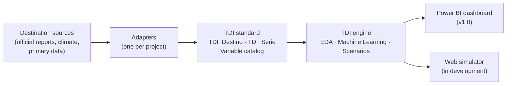
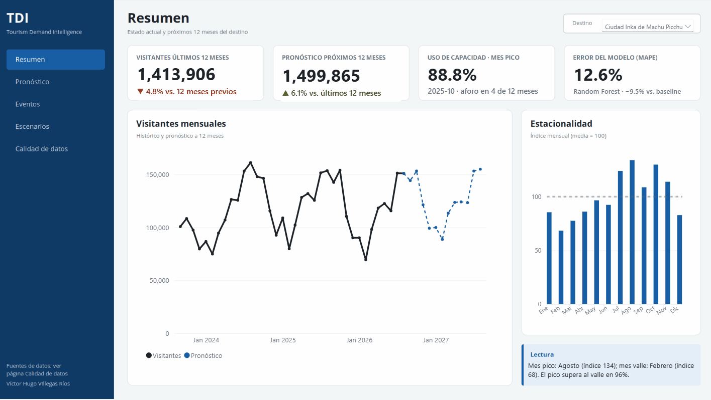
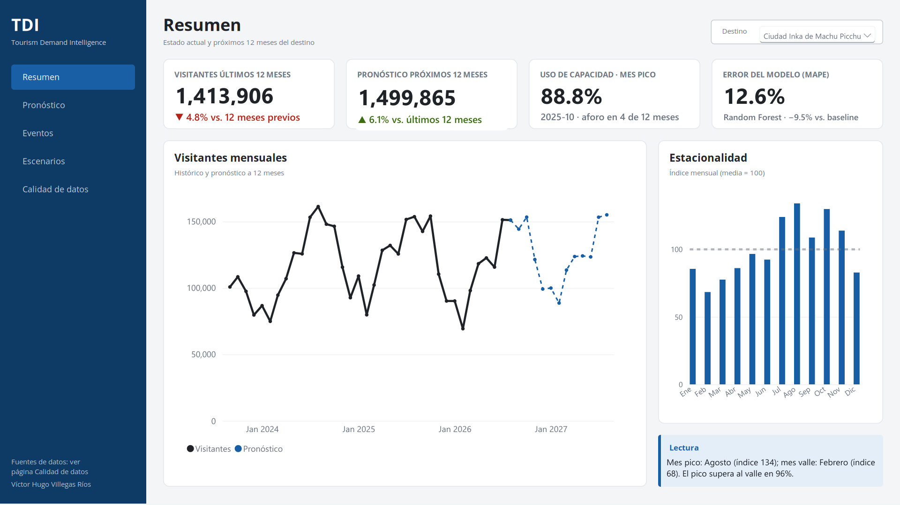
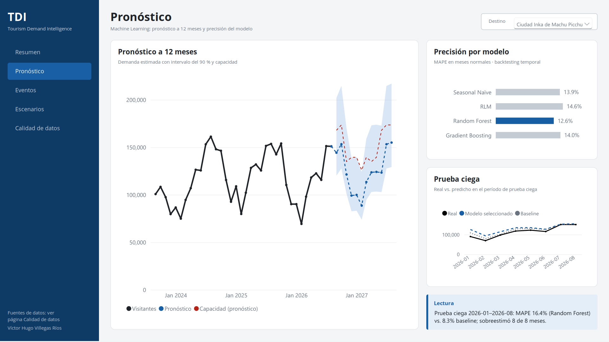
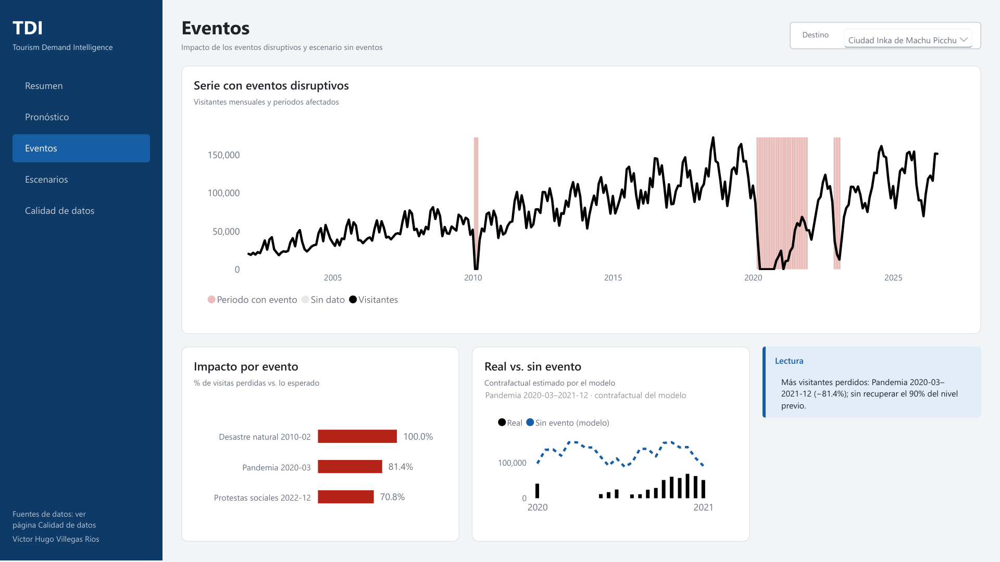
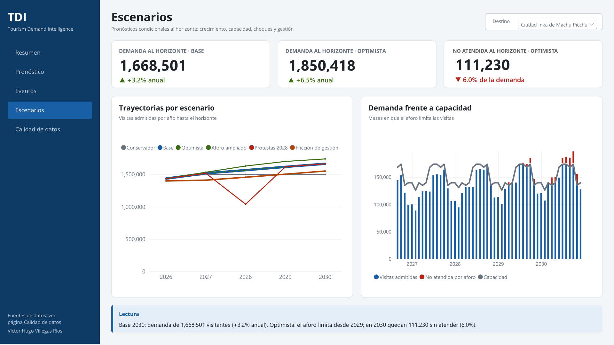
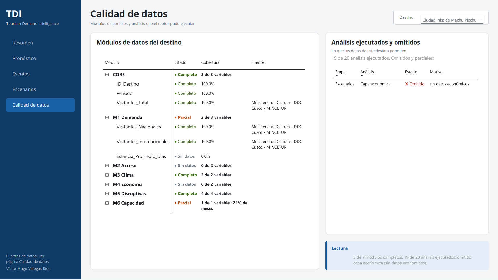
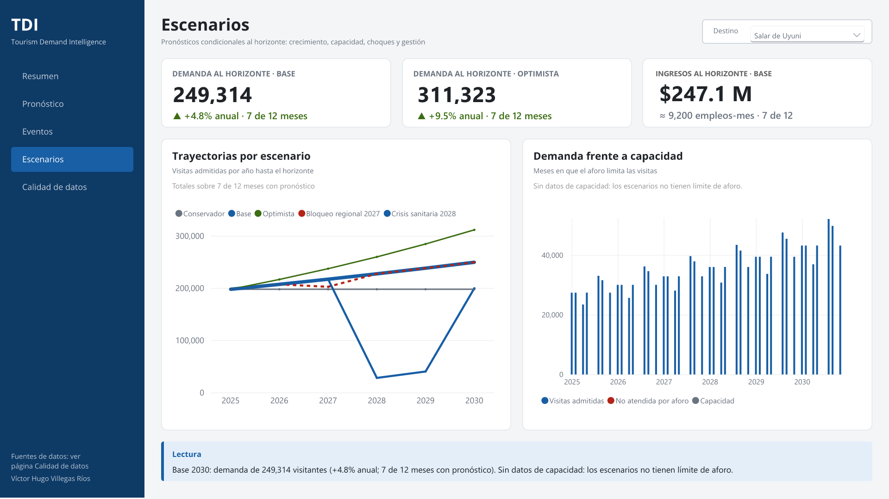
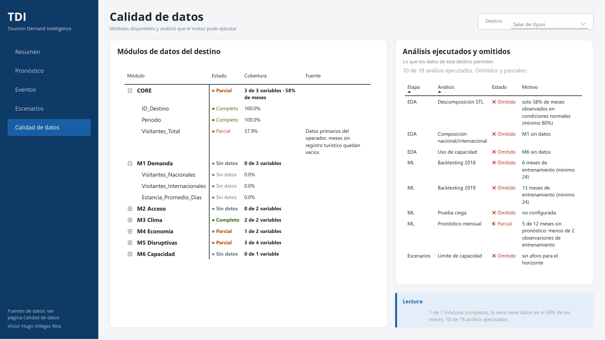
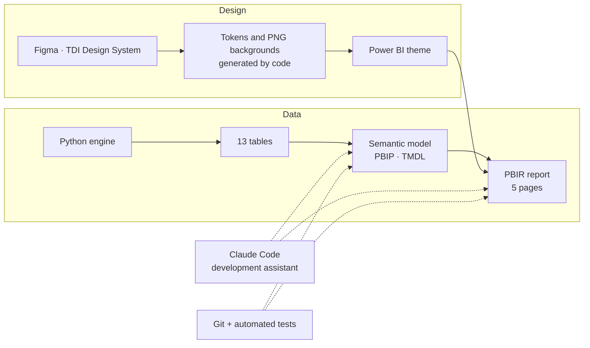

🌐 [Español](README.md) · **English**

# Tourism Demand Intelligence (TDI)

**Tourism demand forecasting and simulation for data-driven destination management: how many visitors will come, when capacity saturates, and what a crisis costs.**

> 🔒 This repository is a portfolio showcase. The source code and full methodology are the author's intellectual property and are not published here. A private demo is available on request.

*Figures are in Spanish.*

---

## What does it solve?

TDI answers the questions a destination manager faces every day:

- **How many visitors will come?** A 12-month Machine Learning forecast with a confidence interval, plus conditional forecasts by scenario up to 2030, calibrated on the destination's own history.
- **When does capacity saturate?** Demand against the current visitor cap, month by month.
- **What does a crisis cost?** Visitors lost to disasters, a pandemic or protests, and how long recovery takes.
- **What if…?** The visitor cap changes, demand grows or falls, a crisis repeats, or access management gets worse.

## The ecosystem



Each destination delivers its data in a **common standard**. From there the engine is the same for all of them: it contains no destination names, and everything specific lives in the project configuration.

## One engine, any destination

The engine diagnoses which data modules each destination has and **adapts**: it runs whatever the data supports and explains what it skips. Two demonstration cases with opposite profiles:

| Module | Machu Picchu (Peru) | Salar de Uyuni (Bolivia) |
|---|---|---|
| CORE (monthly visitors) | Complete | Partial |
| M1 Demand (domestic / international) | Partial | No data |
| M2 Access | No data | No data |
| M3 Climate | Complete | Complete |
| M4 Economy (spending) | No data | Partial |
| M5 Disruptive events | Complete | Partial |
| M6 Capacity (visitor cap) | Partial | No data |

Machu Picchu has **capacity** data but no economic data; the Salar is the other way around. The same code produces, for each one, the analyses its data can support.

**The engine does not invent data.** The Salar series has data for 62 of 108 months (2016–2024). The gaps stay as gaps; they are not filled with zeros or estimates:


The automated tests also run a **synthetic destination** through the whole pipeline. It has only the three minimum variables (destination, period, visitors), and the engine completes EDA, ML and scenarios while explaining every analysis it cannot run.

## Machu Picchu case: the destination in data

Monthly visitors to the Inca City (2002-01 to 2026-08, 296 months), with its disruptive events coded:


| Seasonality | STL decomposition |
|---|---|
|  |  |

Capacity use against the regulatory daily visitor cap:


## Honest Machine Learning

Four models are compared against a demanding baseline: **Seasonal Naïve**, which repeats the same month of the previous year. Validation is **temporal and ex-ante**: each test year is predicted using only the past, and events and climate in the forecast period are treated as unknown.

**Backtesting** (6 test years: 2017, 2018, 2019, 2023, 2024 and 2025):

| Model | MAPE in normal months | Mean MAPE |
|---|---|---|
| **Random Forest** (selected) | **12.58%** | 23.65% |
| Seasonal Naïve (baseline) | 13.90% | 18.57% |
| Gradient Boosting | 14.02% | 24.30% |
| Multiple linear regression | 14.55% | 19.63% |

MAPE: mean absolute percentage error of the predictions (lower is better). Normal months: months without disruptive events, which are the ones a model can anticipate.

Random Forest cuts the baseline's error in normal months by ≈ 9.5%.


**Blind test, January–August 2026.** These are 8 months that no model saw during training:

| Model | MAPE | MAE | R² |
|---|---|---|---|
| Seasonal Naïve | **8.3%** | 8,200 | 0.864 |
| Random Forest | 16.4% | 15,634 | 0.509 |
| Gradient Boosting | 17.5% | 17,111 | 0.440 |
| Multiple linear regression | 19.9% | 20,965 | 0.309 |

Random Forest forecast 1,041,673 visitors and 916,599 were recorded (+13.6%). **All four models overestimated all eight months**, the baseline included.


**Interpretation.** The 2026 series came in below what the trend anticipated. The gap is consistent with supply constraints documented that year in the ticketing system. According to press reports, an audit report found that 62.9% of 209,051 reservations analyzed ended up cancelled [1], the Government attributed the drop in visitors to problems with the ticketing platform [2], and the end of advance booking was announced in September 2026 [1]. **The model estimates demand, and the difference points to factors holding the destination back.**

A 12-month forecast with a 90% interval, and a counterfactual showing how many visitors there would have been without the disruptive events:

| Forecast | Counterfactual |
|---|---|
|  |  |

## Events and scenarios

**Event impact.** Visitors lost compared with what the previous normal years predicted:

| Event | Period | Months | Loss |
|---|---|---|---|
| Natural disaster | 2010-02 to 2010-03 | 2 | 100% |
| Pandemic | 2020-03 to 2021-12 | 22 | 81.4% |
| Social protests | 2022-12 to 2023-02 | 3 | 70.8% |


**A shock library calibrated on the destination's own history.** Each event contributes its magnitude, its duration and its month-by-month recovery curve. For example, after the protests the destination took 9 months to return to 90% of expected levels. The library feeds the scenarios: "what if the protests repeat in 2028?" is simulated with the real footprint they left, not with a generic assumption.

**Scenarios to 2030.** Growth is derived from the destination's historical rate and combined with capacity levers, shocks and management friction:

| Scenario (2030) | Demand | Admitted visits | Unmet demand |
|---|---|---|---|
| Conservative | 1,499,865 | 1,499,865 | 0 |
| Base | 1,668,501 | 1,664,001 | 4,500 |
| Optimistic | 1,850,418 | 1,739,188 | 111,230 |
| Expanded cap | 1,668,501 | 1,668,501 | 0 |
| Management friction (7%) | 1,668,501 | 1,551,706 | 116,795 |

- **Protests 2028:** repeating the 2022–23 shock cuts 2028 demand by 33.6% compared with Base.
- **Capacity:** with high growth, the visitor cap becomes the binding constraint around 2028–2030 (≈111 thousand unmet visits in 2030, 6%). In the base scenario it barely starts to bind in 2030 (0.3%). Expanding the cap removes that gap.

| Annual scenarios | Demand vs. capacity |
|---|---|
|  |  |

## Quality and rigor

- **28 automated tests:**
  - data contract;
  - genericity (the engine mentions no destination);
  - synthetic destination;
  - scenario simulator;
  - model regression.
- **Ex-ante temporal validation:** no model knows the future it predicts.
- **Traceability:** every coded event and every capacity period records its source and whether it has been verified.
- **Reproducibility:** the standard data is regenerated from the original sources with a single command, with no manual steps.

## Power BI Dashboard

The engine feeds a five-page Power BI report. It is a single report for any destination: the Destination selector adapts cards, charts and text to the available data. Whatever a destination's data cannot support is shown as a gap or as a skipped analysis with its reason; it is never filled in.



### Walkthrough: Machu Picchu

**Summary. How is the destination doing today?** Visitors over the last 12 months, forecast, capacity use, model error and seasonality.



**Forecast. What's coming, and how much should we trust it?** 12-month forecast with a 90% band, accuracy by model and a blind test. The blind test is shown even when the model loses: in Machu Picchu the seasonal baseline (8.3% error) beat Random Forest (16.4%).



**Events. What did disruptions cost?** Full series with event periods and months without data, visitors lost per event, and actual versus no-event comparison.



**Scenarios. What happens toward 2030?** Trajectories by scenario, demand versus capacity, and the first year capacity becomes binding.



**Data quality. What does the data allow, and what not?** Modules and variables with their status, coverage and source, plus skipped or partial analyses with their reason.



### Same report, another destination: Salar de Uyuni

The Salar has data for 58% of months and no known capacity limit. The report doesn't change, it adapts: the third Scenarios card switches from unmet demand to revenue and job-months, and Data quality explains why only 10 of 18 analyses could run.





### How it's built



The whole report lives as versioned text: model, measures, pages and buttons. Design is done in Figma and translated into code-generated backgrounds and a Power BI theme. The model and pages are developed with Claude Code as an assistant, under written conventions, and every change is checked by automated tests covering report structure, navigation, interactions and engine regression.

### Conventions

- **No invented data.** Gaps stay visible, and anything that can't be computed is shown as skipped, with its reason.
- **One control filters.** The Destination selector; visuals don't cross-filter each other.
- **Self-writing text.** Cards and readings are generated by measures and change with the destination.

### DAX sample

**Valor tercera tarjeta Escenarios**: the third Scenarios card shows unmet demand for destinations with a known capacity, or Base-scenario revenue for destinations with economic data.

```dax
IF (
    [_Destino único],
        SWITCH (
            TRUE (),
            SELECTEDVALUE ( Dim_Destino[Tiene_Capacidad] ) = "Sí", FORMAT ( [No atendida por aforo al horizonte · Optimista], "#,0", "en-US" ),
            SELECTEDVALUE ( Dim_Destino[Tiene_Economia] ) = "Sí",
                VAR _i = [Ingresos al horizonte · Base]
                RETURN
                    IF ( ISBLANK ( _i ), "Sin datos", "$" & FORMAT ( _i / 1000000, "#,0.0", "en-US" ) & " M" ),
            "Sin datos"
        ),
    BLANK ()
)
```

**Cobertura módulo o variable**: for a variable it shows its coverage; for a module, how many variables have data; if the module is partial because of time, it adds the month coverage of its lowest variable.

```dax
SWITCH (
    TRUE (),
    ISINSCOPE ( Fact_Variables[Variable] ),
        VAR _c = SELECTEDVALUE ( Fact_Variables[Cobertura_pct] )
        RETURN
            IF (
                ISBLANK ( _c ),
                BLANK (),
                FORMAT ( _c / 100, "0.0%", "en-US" ) & IF ( SELECTEDVALUE ( Fact_Variables[Cobertura_Origen] ) = "Declarada", " *", "" )
            ),
    ISINSCOPE ( Fact_Variables[Modulo] ),
        VAR _m = CALCULATETABLE ( Fact_Modulos, TREATAS ( VALUES ( Fact_Variables[Modulo] ), Fact_Modulos[Modulo] ) )
        VAR _con = SUMX ( _m, Fact_Modulos[Variables_con_datos] )
        VAR _tot = SUMX ( _m, Fact_Modulos[Variables_totales] )
        VAR _estado = MAXX ( _m, Fact_Modulos[Estado] )
        -- parcial con todas sus variables: lo limita la cobertura temporal (variable con menos meses, ventana del target)
        VAR _meses = MIN ( Fact_Variables[Cobertura_pct] )
        RETURN
            IF (
                ISBLANK ( _tot ),
                BLANK (),
                FORMAT ( _con, "0", "en-US" ) & " de " & FORMAT ( _tot, "0", "en-US" ) & IF ( _tot = 1, " variable", " variables" )
                    & IF ( _estado = "Parcial" && _con = _tot, " · " & FORMAT ( _meses / 100, "0%", "en-US" ) & " de meses", "" )
            )
)
```

### Known limitations

Polish details documented and left out of v1.0: lines bridging gaps in series with missing months, a capacity legend shown for destinations without a capacity limit, slanted labels in Seasonality, and the wording of a capacity-coverage note.

> The report file is not published in this repository. A demo is available on request.

## Products

| Product | Status |
|---|---|
| Analytics engine (EDA, ML, scenarios) | ✔ v0.4 |
| Power BI dashboard | ✔ [v1.0](#power-bi-dashboard) |
| Web scenario simulator | In development |

## Stack

Python (pandas, scikit-learn, statsmodels) · Power BI (PBIP · TMDL · PBIR), DAX · Streamlit

## Roadmap

- ✔ **v0.4:** generic engine, adaptation layer and automated tests
- ✔ Power BI dashboard (v1.0)
- ◻ Web simulator

## Data sources

- **Machu Picchu:** Peru's Ministry of Culture, Decentralized Directorate of Culture of Cusco, compiled by MINCETUR (visitor arrivals); official notes and press (events); capacity resolutions and protocols.
- **Climate:** NASA POWER (MERRA-2).
- **Salar de Uyuni:** the author's primary data.

> Demonstration cases built with public data (Machu Picchu) and the author's primary data (Salar de Uyuni). They are not official forecasts and do not represent the position of any institution.

## References

1. Latin Times, October 2026: "Informe de Auditoría N° 007-2026" (62.9% of 209,051 reservations cancelled) and the end of advance booking announced on September 11, 2026. https://latintimes.com/more-90000-machu-picchu-tickets-open-giving-travelers-new-chance-visit-before-2026-year-end-599967
2. América TV, September 2026: the Government attributes the drop in visitors to problems with the ticketing platform. https://www.americatv.com.pe/noticias/actualidad/machu-picchu-gobierno-anuncia-nuevo-sistema-venta-entradas-ante-caida-visitantes-n522565

## Author

**Víctor Hugo Villegas Ríos**, freelance data analytics and data science consultant.

- LinkedIn: https://www.linkedin.com/in/victorhugovillegasrios/
- GitHub: https://github.com/VictorHugoVillegasRios
