🌐 **Español** · [English](README.en.md)

# Tourism Demand Intelligence (TDI)

**Predicción y simulación de la demanda turística para gestionar destinos con datos: cuántos visitantes vendrán, cuándo se satura la capacidad y cuánto cuesta una crisis.**

> 🔒 Este repositorio es una vitrina de portafolio. El código fuente y la metodología completa son propiedad intelectual del autor y no se publican aquí. Demo privada disponible bajo consulta.

---

## ¿Qué resuelve?

TDI responde las preguntas que se hace a diario quien gestiona un destino turístico:

- **¿Cuántos visitantes vendrán en los próximos 12 meses?** Pronóstico mensual con intervalo de confianza.
- **¿Cuándo se satura la capacidad?** Demanda frente al aforo vigente, mes a mes.
- **¿Cuánto cuesta una crisis?** Visitantes perdidos en desastres, pandemia o protestas, y cuánto tarda la recuperación.
- **¿Qué pasa si…?** Cambia el aforo, crece o cae la demanda, se repite una crisis o empeora la gestión del acceso.

## El ecosistema

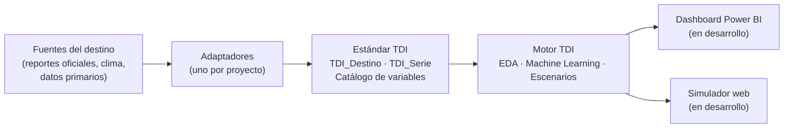

Cada destino entrega sus datos en un **estándar común**. A partir de ahí, el motor es el mismo para todos: no contiene ningún nombre de destino y todo lo específico vive en la configuración del proyecto.

## Un motor, cualquier destino

El motor diagnostica qué módulos de datos tiene cada destino y **se adapta**: ejecuta lo que los datos permiten y explica lo que omite. Dos casos de demostración con perfiles opuestos:

| Módulo | Machu Picchu (Perú) | Salar de Uyuni (Bolivia) |
|---|---|---|
| CORE (visitantes mensuales) | Completo | Parcial |
| M1 Demanda (nacional / internacional) | Parcial | Sin datos |
| M2 Acceso | Sin datos | Sin datos |
| M3 Clima | Completo | Completo |
| M4 Economía (gasto) | Sin datos | Parcial |
| M5 Eventos disruptivos | Completo | Parcial |
| M6 Capacidad (aforo) | Parcial | Sin datos |

Machu Picchu tiene **capacidad** pero no economía; el Salar, al revés. El mismo código produce para cada uno los análisis que sus datos sostienen.

**El motor no inventa datos.** La serie del Salar tiene 62 meses con dato de 108 (2016–2024). Los huecos se quedan como huecos, no se rellenan con ceros ni con estimaciones:

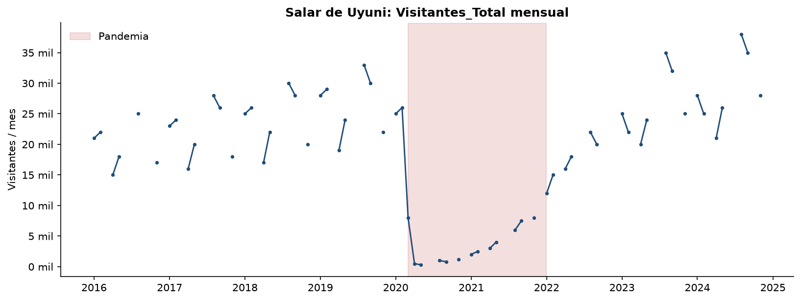

Además, las pruebas automatizadas hacen pasar por todo el flujo un **destino sintético** que solo tiene las tres variables mínimas (destino, periodo, visitantes). El motor completa EDA, ML y escenarios y explica cada análisis que no puede ejecutar.

## Caso Machu Picchu: el destino en datos

Serie mensual de visitantes a la Ciudad Inka (2002-01 a 2026-08, 296 meses) con sus eventos disruptivos codificados:

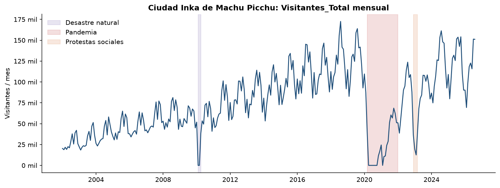

| Estacionalidad | Descomposición STL |
|---|---|
| 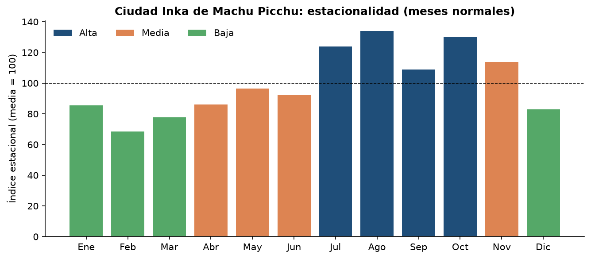 | 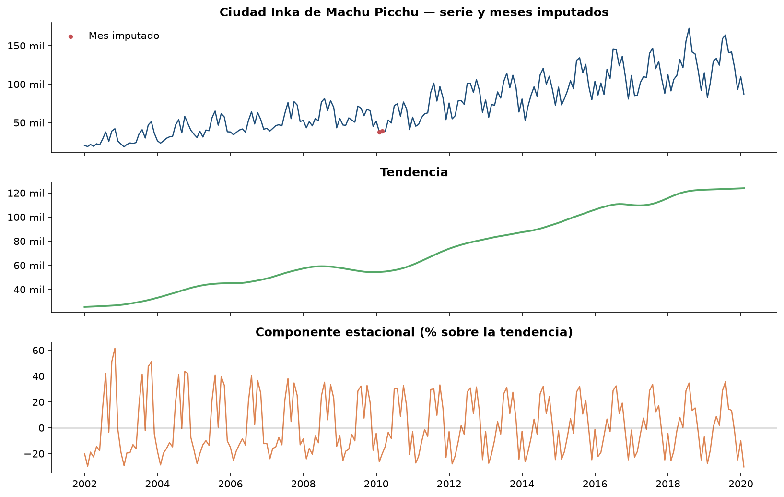 |

Uso de la capacidad frente al aforo diario normativo:

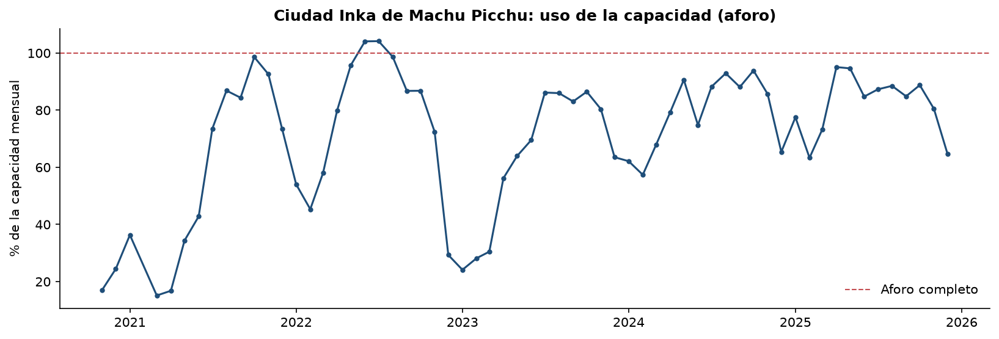

## Machine Learning con honestidad

Se comparan cuatro modelos contra un baseline exigente: **Seasonal Naïve**, que repite el mismo mes del año anterior. La validación es **temporal y ex-ante**: cada año de prueba se predice solo con el pasado, y los eventos y el clima del periodo pronosticado se tratan como desconocidos.

**Backtesting** (6 años de prueba: 2017, 2018, 2019, 2023, 2024 y 2025):

| Modelo | MAPE en meses normales | MAPE medio |
|---|---|---|
| **Random Forest** (seleccionado) | **12,58 %** | 23,65 % |
| Seasonal Naïve (baseline) | 13,90 % | 18,57 % |
| Gradient Boosting | 14,02 % | 24,30 % |
| Regresión lineal múltiple | 14,55 % | 19,63 % |

Random Forest reduce un 9 % el error del baseline en meses normales.

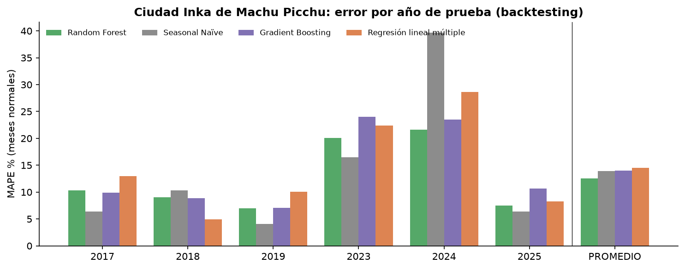

**Prueba ciega, enero–agosto 2026.** Son 8 meses que ningún modelo vio al entrenarse:

| Modelo | MAPE | MAE | R² |
|---|---|---|---|
| Seasonal Naïve | **8,3 %** | 8.200 | 0,864 |
| Random Forest | 16,4 % | 15.634 | 0,509 |
| Gradient Boosting | 17,5 % | 17.111 | 0,440 |
| Regresión lineal múltiple | 19,9 % | 20.965 | 0,309 |

Random Forest pronosticó 1.041.673 visitantes y se registraron 916.599 (+13,6 %). **Los cuatro modelos sobreestimaron los ocho meses**, incluido el baseline.

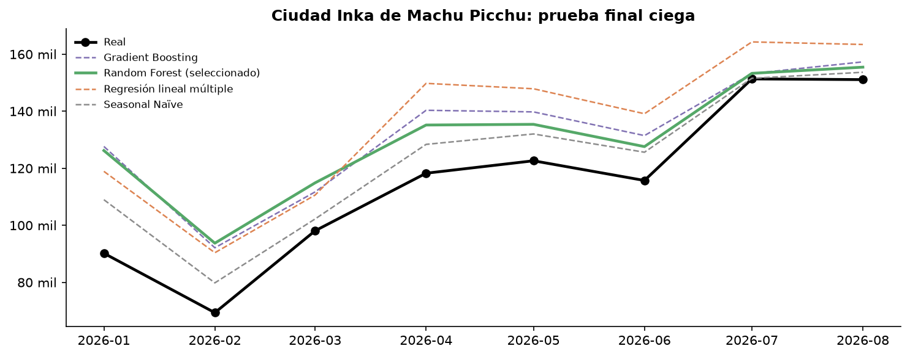

**Lectura.** La serie de 2026 quedó por debajo de lo que la tendencia anticipaba. La brecha es consistente con limitaciones de oferta documentadas ese año en el sistema de venta de entradas. Según la prensa, un informe de auditoría encontró que el 62,9 % de 209.051 reservas analizadas terminó cancelado [1], el Gobierno atribuyó la caída de visitantes a problemas en la plataforma de venta [2] y en septiembre de 2026 se anunció la eliminación de la reserva anticipada [1]. **El modelo estima la demanda, y la diferencia señala factores que frenan al destino.**

Pronóstico a 12 meses con intervalo del 90 %, y contrafactual: cuántos visitantes habría habido sin los eventos disruptivos.

| Pronóstico | Contrafactual |
|---|---|
| 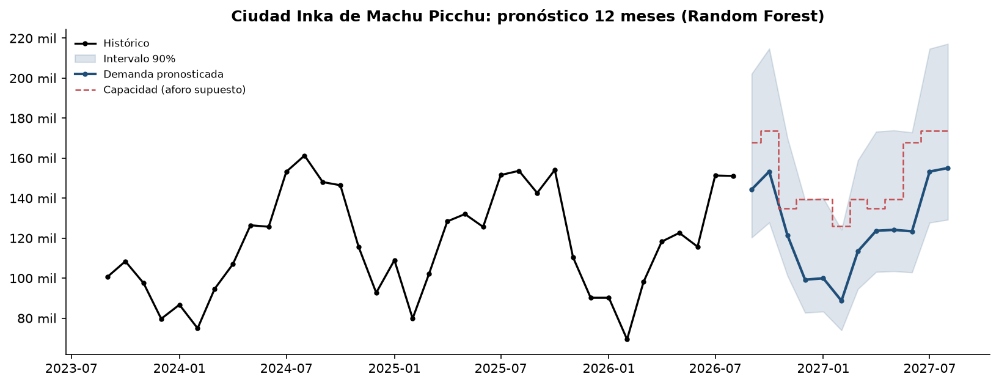 | 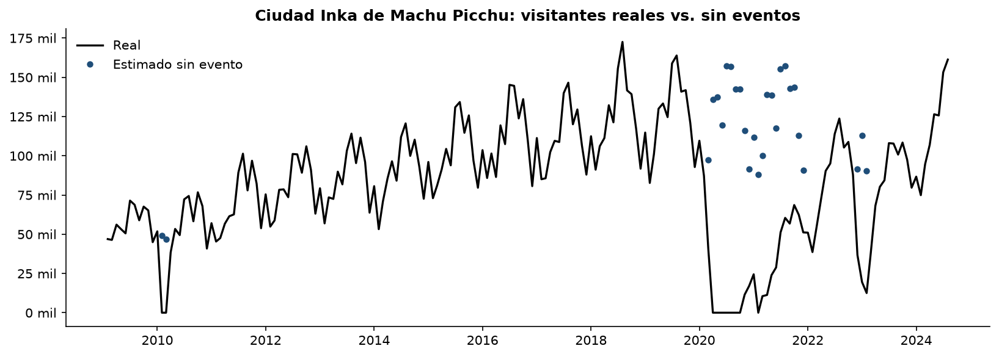 |

## Eventos y escenarios

**Impacto de los eventos.** Visitantes perdidos frente a lo esperado según los años normales previos:

| Evento | Periodo | Meses | Pérdida |
|---|---|---|---|
| Desastre natural | 2010-02 a 2010-03 | 2 | 100 % |
| Pandemia | 2020-03 a 2021-12 | 22 | 81,4 % |
| Protestas sociales | 2022-12 a 2023-02 | 3 | 70,8 % |

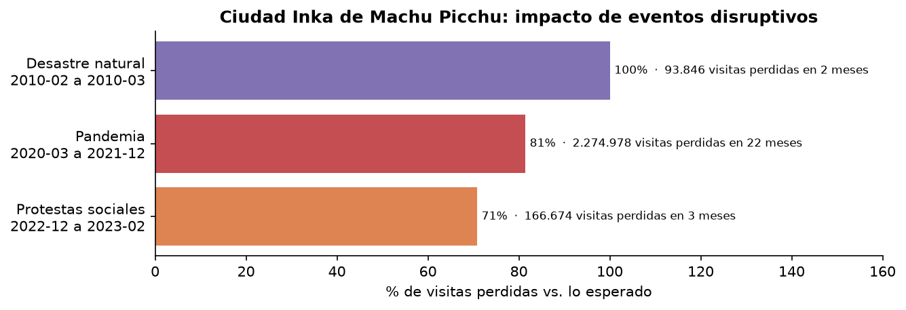

**Biblioteca de choques calibrada con la historia del propio destino.** Cada evento aporta su magnitud, su duración y su curva de recuperación mes a mes. Por ejemplo, tras las protestas, el destino tardó 9 meses en volver al 90 % de lo esperado. Esa biblioteca alimenta los escenarios: "¿y si en 2028 se repiten las protestas?" se simula con la huella real que dejaron, no con un supuesto genérico.

**Escenarios a 2030.** El crecimiento se deriva de la tasa histórica del destino y se combina con palancas de aforo, choques y fricción de gestión:

| Escenario (2030) | Demanda | Visitas admitidas | Demanda no atendida |
|---|---|---|---|
| Conservador | 1.499.865 | 1.499.865 | 0 |
| Base | 1.668.501 | 1.664.001 | 4.500 |
| Optimista | 1.850.418 | 1.739.188 | 111.230 |
| Aforo ampliado | 1.668.501 | 1.668.501 | 0 |
| Fricción de gestión (7 %) | 1.668.501 | 1.551.706 | 116.795 |

- **Protestas 2028:** repetir el choque de 2022–23 reduce la demanda de 2028 un 33,6 % frente a la Base.
- **Capacidad:** con crecimiento alto, el aforo se vuelve la restricción hacia 2028–2030 (≈111 mil visitas no atendidas en 2030, 6 %). En el escenario base apenas empieza a restringir en 2030 (0,3 %). Ampliar el aforo elimina esa brecha.

| Escenarios anuales | Demanda frente a capacidad |
|---|---|
| 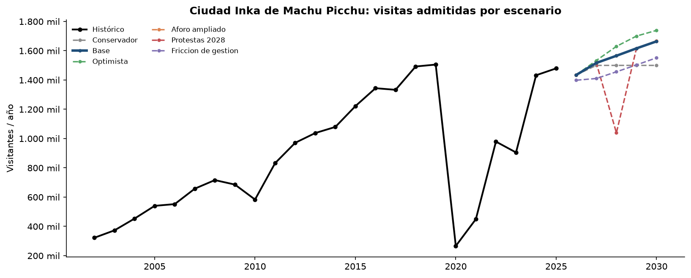 | 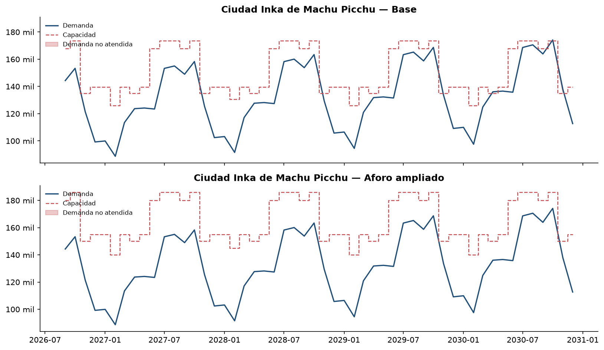 |

## Calidad y rigor

- **28 pruebas automatizadas:**
  - contrato de datos;
  - genericidad (el motor no menciona ningún destino);
  - destino sintético;
  - simulador de escenarios;
  - regresión del modelo.
- **Validación temporal ex-ante:** ningún modelo conoce el futuro que predice.
- **Trazabilidad:** cada evento codificado y cada tramo de aforo registra su fuente y si está verificado.
- **Reproducibilidad:** los datos del estándar se regeneran desde las fuentes originales con un solo comando, sin pasos manuales.

## Productos

| Producto | Estado |
|---|---|
| Motor analítico (EDA, ML, escenarios) | ✔ v0.4 |
| Dashboard Power BI | En desarrollo |
| Simulador web de escenarios | En desarrollo |

## Stack

Python (pandas, scikit-learn, statsmodels) · Power BI · Streamlit

## Hoja de ruta

- ✔ **v0.4:** motor genérico, capa de adaptación y pruebas automatizadas
- ◻ Dashboard Power BI
- ◻ Simulador web

## Fuentes de datos

- **Machu Picchu:** Ministerio de Cultura del Perú, Dirección Desconcentrada de Cultura de Cusco, con elaboración de MINCETUR (llegada de visitantes); notas oficiales y prensa (eventos); resoluciones y protocolos de aforo.
- **Clima:** NASA POWER (MERRA-2).
- **Salar de Uyuni:** datos primarios del autor.

> Caso demostrativo construido con datos públicos. No es un pronóstico oficial ni representa la posición de ninguna institución.

## Referencias

1. Latin Times, octubre de 2026: "Informe de Auditoría N° 007-2026" (62,9 % de 209.051 reservas canceladas) y eliminación de la reserva anticipada anunciada el 11 de septiembre de 2026. https://latintimes.com/more-90000-machu-picchu-tickets-open-giving-travelers-new-chance-visit-before-2026-year-end-599967
2. América TV, septiembre de 2026: el Gobierno atribuye la caída de visitantes a problemas en la plataforma de venta de entradas. https://www.americatv.com.pe/noticias/actualidad/machu-picchu-gobierno-anuncia-nuevo-sistema-venta-entradas-ante-caida-visitantes-n522565

## Autor

**Víctor Hugo Villegas Ríos**, consultor freelance en análisis y ciencia de datos.
